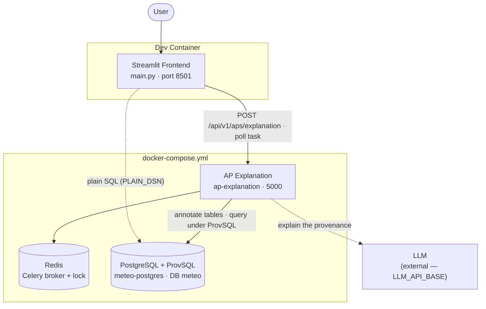

# Provenance Explorer: Zurich weather

A Streamlit app about [**ap-explanation**](https://github.com/datagems-eosc/ap-explanation)
and the meteo question set, in five tabs.

**📋 Summary - ProvSQL 1.12** — all 752 questions in one table, each row coloured: 🟢 supported,
🟡 stopped due to a lack of memory (none: ProvSQL 1.12 has no memory limit), 🟠 crashed by a lack of
memory (exhausts it and nothing stops it: estimated above the 3 GB the measurements allow the
database, killed in the one measured case), 🔴 not supported (refused by ap-explanation v1.2.0,
failing at run time, or not returning the SQL answer: 9 supported templates do arithmetic on
aggregates that ProvSQL 1.12 gets wrong). 462 supported, 0 stopped, 46 crashed, 244 not supported.

**📋 Summary - ProvSQL 1.13** — the same table on ProvSQL 1.13 (1.13.0, released 17 October 2026),
through ap-explanation master (`a6cf3ea`), whose rewriter is adapted to it
(`LIMIT plain(k)`, rows kept where `present(provenance())`, `HAVING` accepted). 569 are supported, 4 are stopped
due to a lack of memory, 25 crashed by a lack of memory, 154 are not supported, and every supported template that works on ProvSQL 1.12
still works. Each question says what blocks it: a ProvSQL limit (115, among them `PERCENTILE_CONT`,
`REGR_SLOPE`, `CORR` and a `LIMIT` in a CTE), memory or time (48: 4 stopped, 25 crashes, 19 not finished), the demo's data (12) or the
question's own SQL (8). None is blocked by ap-explanation or by a ProvSQL bug any more.

**📋 Summary - ProvSQL 1.14 - master@3b8d3098** — the same table on ProvSQL's master branch (1.14.0-dev, 26 October 2026), sent to ap-explanation `feat/formula-rows` (`bbb56a6`): master with the pre-check that refuses an aggregate over more than 8,000,000 rows or whose plain SQL takes over 60 s, and an aggregate's formula read as its first 100 rows with `sr_formula_rows`. The City of Zurich questions, and the Attica ones on the demo's data copied to Attica's 24 cells (`prepare … --regions=Attica`), were run on this build; the Canton of Bern and Peloponnese ones keep their 1.13.0 outcome. 509 supported, 124 with caveats, 10 runtime crashes (all of Bern and the Peloponnese, not rerun), 109 not supported: no question run on this build crashes the database.

**🧠 Memory** — the 82 questions estimated to exhaust memory, run through ap-explanation on
ProvSQL 1.13, on the demo's data copied to every cell of their region, in a database capped at
3 GB with `provsql.max_memory = '1GB'`. Two problems: a comparison on an aggregate (`HAVING`,
`= (SELECT MAX(…))`), whose memory triples with each row of the group, is now mostly refused
in seconds by `provsql.max_worlds`; an aggregate over many rows (the elevation points of a
region) still takes the database down (16 questions) or does not finish (18), because the budget
covers only the query's own process, not ProvSQL's circuit store or parallel workers.

**💽 Disk** — what fills the database's disk: the annotation (one mapping table shared by the semirings,
about 0.6× the table), ProvSQL's circuit store (grows with every query, 4 GB for one question, until
`provsql.circuit_cleanup()` is run with the database to itself), and temporary files of large joins (no limit by default).

| Script | Output | What it does |
|--------|--------|--------------|
| `scripts/memory_analysis.py` | `assets/memory_risk.csv` | Finds both memory problems in the SQL of every question (sqlglot) and estimates their memory |
| `scripts/memtest_group_size.sh` | `assets/memory_group_size.csv` | Measures a comparison on an aggregate against the size of its group, the basis of the estimates |
| `scripts/memtest_questions.py` | `assets/memory_sweep.jsonl` | Runs questions through ap-explanation on ProvSQL 1.12 and records their peak memory |
| `scripts/apx_service_check.py run … zurich` | `assets/apx_service_112.jsonl`, `assets/apx_service_113_master.jsonl` | The City of Zurich question of every template sent to ap-explanation itself (`APX_IMAGE`), which annotates the tables and asks for every semiring |
| `scripts/apx_service_check.py run … --max-memory=1GB --reuse` | `assets/apx_service_113_memory.jsonl` | The questions that may exhaust memory, on the demo's data copied to their region's cells (`prepare … --regions`), through ap-explanation master |
| `scripts/provsql_compare.py sweep` / `checks` | `assets/provsql_113_sweep.jsonl`, `assets/provsql_113_sweep_maxmem1g.jsonl`, `assets/provsql_113_checks.jsonl` | Runs queries straight on ProvSQL 1.12 and 1.13 (circuit store growth, the memory budget, run-time checks) |

The measurement scripts need a throwaway, memory-capped database; their docstrings give the
commands. Never run them against a shared database. `scripts/provsql_compare.py` needs a
checkout of ap-explanation at v1.2.0 (for its SQL rewriter) and one database image per ProvSQL
version, annotated by `scripts/provsql_compare_setup.sql`; `scripts/apx_service_check.py` needs
the ap-explanation image and snapshots the service itself annotated. The `--regions` snapshot
holds 41 million elevation points (45.6 GB): a container started from it copies every file it
writes to, hence `--reuse`, and never start it with less free disk than that. The tables the
demo's seed lacks (`meteo_tmean`, `meteo_sdmax`, `meteo_ssrd`, land cover) are stand-ins derived
from the readings at hand (`scripts/meteo_standins.sql`).

**🔎 Query runner** — runs a question through ap-explanation and shows:

| Section | What it shows | Source |
|---------|---------------|--------|
| **SQL** | The query of the AP's `Provenance_SQL_Operator` | `assets/aps/<ID>.json` |
| **Run cost** | Total time, database time, peak database memory, plain SQL time | see [Run cost](#run-cost) |
| **1. Plain SQL answer** | What SQL alone returns | the query run on the database, without ProvSQL |
| **2. What provenance adds** | Per result row, the ProvSQL formula and the readings it cites (date, place, value in °C / mm / m/s) | `ap-explanation` `POST /api/v1/aps/explanation[/{semiring}]` |
| **3. LLM explanation** | The explanation ap-explanation writes from the query, its answer and the provenance | same call |

Each question can be **run live** on ap-explanation (about 15–40 s, mostly the LLM call) or
**replayed** from the response recorded when the demo was made (`assets/recorded/`), which needs
no service at all.

## The questions

Six questions from the meteo question set, over one ERA5 cell (City of Zurich, 47.4 / 8.5,
2005–2019). They come from ap-explanation's `fixtures/meteo_examples/` (see its `NOTES.md`).

| AP | Question | Tables | What the provenance adds |
|----|----------|--------|--------------------------|
| G81 | 10 lowest temperatures, July 2015 | `meteo_tmin` | the date of each temperature |
| F50 | Number of readings above 30 °C in 2015 | `meteo_tmax` | the 13 hot days behind the count |
| K247 | Frost days in each January, 2005–2015 | `meteo_tmin` | the dated frost days behind each yearly count |
| C155 | Location of the highest wind speed, 2018–2019 | `meteo_windspeedmax`, `meteo_elevation` | the day of the max (storm Burglind), and that the elevation join is useless |
| T157 | Highest precipitation at the highest point, ISO week 46 of 2011 | `meteo_tp`, `meteo_elevation` | the 7 dry days of the week, each paired with the highest point |
| Q295 | Last month of 2019 with more than 1 mm of precipitation | `meteo_tp` | nothing: **recorded failure only**, see [Known limitations](#known-limitations) |

---

## Run cost

After a live run, the Query runner shows:

- **Total time**: from submitting the AP to the task settling, LLM call included.
- **Database time** and **peak database memory**: a thread samples, every 0.1 s,
  `pg_stat_activity` and each of the run's PostgreSQL backends' `/proc/<pid>/status`
  (through `pg_read_file`, which needs a superuser: the demo's `provdemo` is one). Database
  time adds up the samples where one of the run's backends is running a statement; memory is
  the highest sum of their private memory (`RssAnon`, shared buffers excluded).
  ap-explanation opens a fresh connection pool per task, so the backends that appear during
  the run are the run's.
- **Plain SQL time**: the same query without provenance.

ap-explanation caches results for an hour under a key made of the whole AP. A cache hit
skips all database work, so each live run stamps the AP's `startTime` with the time of the
run, and computes afresh. Recorded runs only have their total and plain SQL times.

---

## Architecture



**Flow of a live run:**

1. The frontend POSTs the AP to ap-explanation and gets a `task_id`. Picking a semiring
   posts to `/{semiring}`; the default computes them all (aggregate queries only get
   `formula`).
2. ap-explanation's Celery task annotates the AP's tables with provenance, runs the query
   under ProvSQL, resolves the rows each formula cites, then asks the LLM to explain it.
3. The frontend polls `GET /api/v1/aps/explanation/{task_id}` until the task settles, and
   runs the same query plainly on `PLAIN_DSN` for comparison.

The database (`meteo-postgres`) is seeded on first start from `dependencies/postgres-seed/`:
`01_meteo.sql` creates schema `meteo` with the column types of the dev server's
`ds_era5_land`, and loads the CSVs in `data/` (fetched from the Open-Meteo archive, model
`era5_seamless`, by ap-explanation's `scripts/meteo_examples/load_era5.py`).

The HTTP client under `generated/` is auto-generated with
[Kiota](https://github.com/microsoft/kiota) from ap-explanation's OpenAPI spec.

---

## Running the demo

### 1. Authenticate with GitHub Container Registry

Sidecar images are on GHCR. Create a [GitHub PAT](https://github.com/settings/tokens)
with the `read:packages` scope, then:

```sh
echo YOUR_GITHUB_PAT | docker login ghcr.io -u YOUR_GITHUB_USERNAME --password-stdin
```

### 2. Pick the ap-explanation image

The meteo questions need the sql_rewriter changes released **after ap-explanation v1.1.1**
(aggregate provenance, `col_<i>` naming). `docker-compose.yml` pins
`ghcr.io/datagems-eosc/datagems-eosc/ap-explanation:v1.2.0`. Until that tag is published,
build an image from an ap-explanation checkout and point at it in `.env`:

```sh
docker build --target prod -t ap-explanation:local ../../ap-explanation
cp .env.example .env
# then in .env:
# AP_EXPLANATION_IMAGE=ap-explanation
# AP_EXPLANATION_TAG=local
```

### 3. Configure the LLM (optional)

Set `LLM_API_BASE`, `LLM_API_KEY` and `LLM_API_MODEL` in `.env` (an OpenAI-compatible
endpoint). Without them, ap-explanation still computes the provenance, but writes no
explanation.

### 4. Open in the dev container

Open the repo in VS Code → **Reopen in Container**. This starts the sidecars (PostgreSQL +
ProvSQL, Redis, ap-explanation) via `docker-compose.yml`.

### 5. Run the app

```sh
streamlit run main.py
```

With no sidecars at all, the **Show recorded run** button still works; **Run on
ap-explanation** is disabled until `AP_EXPLANATION_SERVICE_URL` answers on `/api/v1/health`.

| Variable | Default | Purpose |
|----------|---------|---------|
| `AP_EXPLANATION_SERVICE_URL` | `http://ap-explanation:5000` | ap-explanation base URL |
| `PLAIN_DSN` | unset | libpq DSN of the database, for the plain SQL answer on live runs |

### Deploying standalone (e.g. Portainer)

Outside the dev container, `docker compose up` reads the same files from a plain
`git clone`. Two gotchas that don't show up in the dev container:

- **Base path.** If a reverse proxy serves the app under a path prefix (the bundled
  Traefik labels use `/demo-explanation`), set `APP_BASE_URL_PATH` (e.g. in Portainer's
  stack environment variables) to that same prefix, or the UI loads a blank page.
- **Seed data.** `meteo-postgres` is built from `dependencies/postgres-seed/Dockerfile`, which
  copies the ERA5 seed SQL and CSVs into the image. They are not bind-mounted because a
  stack deployed from git by Portainer does not see the clone's relative paths on the Docker
  host: the mount came up empty, Postgres logged `ignoring /docker-entrypoint-initdb.d/*`, and
  every query failed with `relation "meteo_tmin" does not exist`. The data is loaded on the
  container's first start only; it has no named volume, so recreating the container re-seeds
  it. To fix a stack stuck on an empty database, redeploy it with the image rebuilt
  (**Update the stack**, with *Re-pull image and redeploy* on). Check with
  `docker compose exec meteo-postgres psql -U provdemo -d meteo -c '\dt meteo.*'`: five
  tables, `meteo_tmin`/`tmax`/`tp`/`windspeedmax` at 5,478 rows each and `meteo_elevation`
  at 134,280.

---

## Known limitations

- **Q295 can take the database down.** Its filter compares a `SUM` computed in a CTE, which
  ProvSQL evaluates as a comparison over an aggregate. On real data it used up 54 GB of memory
  in about 6 minutes, with every semiring and with `formula` alone, and ProvSQL 1.12 ignores
  `statement_timeout` and `pg_terminate_backend` while evaluating it. The demo only replays its
  recorded failure. The same holds for any comparison on an aggregate (HAVING-like filters).
  ProvSQL 1.13 refuses such a comparison instead (see the *Memory* tab).
- **ProvSQL 1.13 needs ap-explanation master.** The demo stays on ProvSQL 1.12 with
  ap-explanation v1.2.0, which on ProvSQL 1.13 breaks G81, C155 and T157 (`ORDER BY … LIMIT k`
  read in every possible world); master rewrites the queries for ProvSQL 1.13 and requires it.
- **One AP at a time per database.** ap-explanation holds a Redis lock per database while a task
  runs, so concurrent runs queue.
- **Tables stay annotated between runs.** ap-explanation leaves the provenance columns in place.
  They are invisible to plain SQL, since `provsql.active` is off unless a session turns it on.
- **Later runs are cheaper than the first one.** Tables stay annotated, so only the first
  live run of a table pays for annotating it.
- **The recorded explanations are frozen.** The takeaway shown above the provenance was written
  for the recorded run, so it is only shown there.

---

## Regenerating the API client

```sh
make clients
```

The client is generated from the vendored spec `openapi/ap_explanation.json`, so it doesn't
depend on which image is running. Refresh the spec from a running service with:

```sh
curl -s http://ap-explanation:5000/openapi.json > openapi/ap_explanation.json
```
